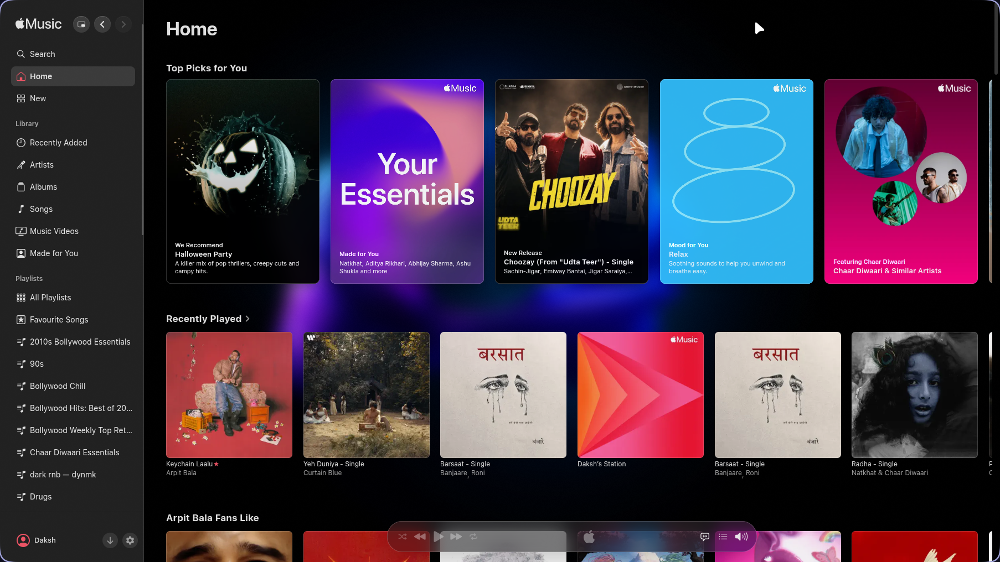
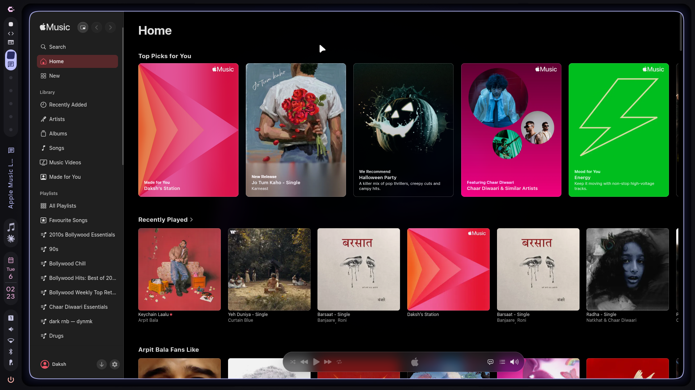
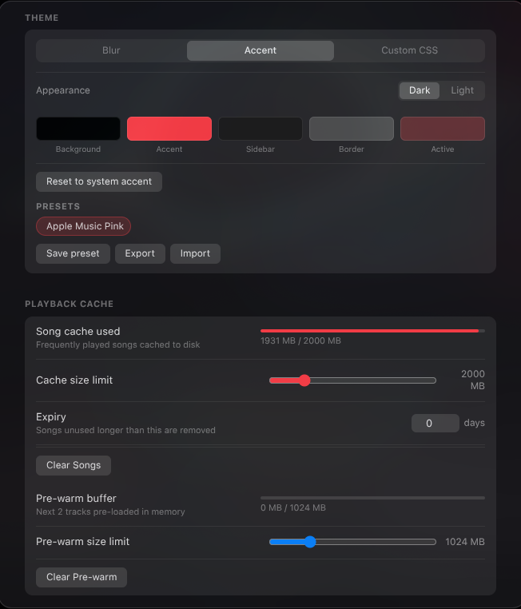
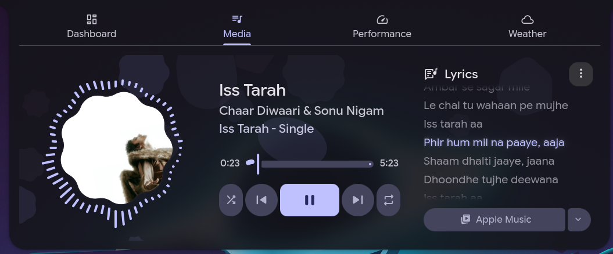
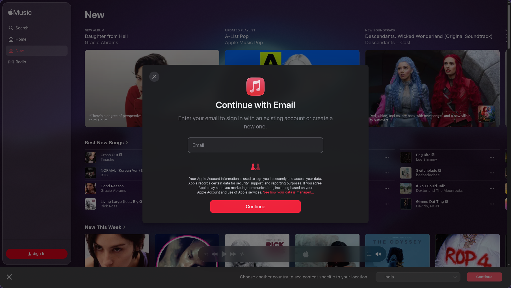
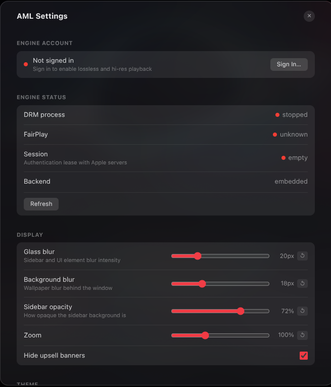
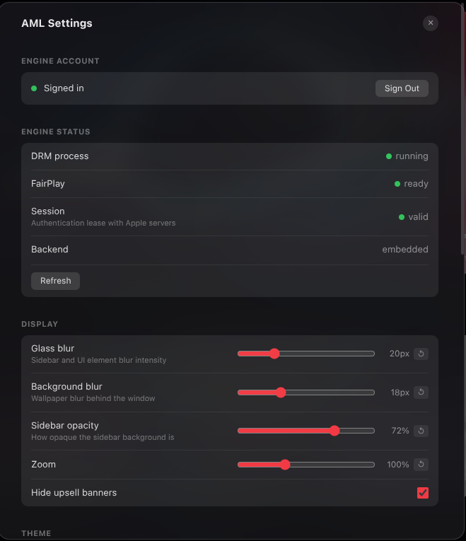

<div align="center">

# Adam

[](https://github.com/silentone12725/apple-music-linux/releases/latest)
[](LICENSE)
[](https://github.com/silentone12725/apple-music-linux/releases/latest)
[](https://discord.gg/tY4v52KpVV)

An Apple Music desktop client for Linux and Windows — lossless audio on Linux, music videos, downloads, and a native-feeling UI.

<div align="center">
  
  
</div>

</div>

> [!IMPORTANT]
> **Disclaimer**
>
> **No Affiliation**
>
> This project and its contributors are not affiliated with, authorized by, endorsed by, or in any way officially connected with Apple Inc. or any of its subsidiaries or affiliates. This is an independent, unofficial client developed for personal use.
>
> **Trademarks**
>
> "Apple Music", "Apple", and related names, marks, and logos are registered trademarks of Apple Inc. Any use of these trademarks is for identification and reference purposes only and does not imply any association with the trademark holder.
>
> **Limitation of Liability**
>
> This application is provided "AS IS". The developers are not liable for any claim, damages, or legal consequences arising from its use. You use it entirely at your own risk. An active Apple Music subscription is required.

## Contents

[Features](#features) · [Roadmap](#roadmap) · [Requirements](#requirements) · [Download & Install](#download--install) · [Opening links](#opening-links-in-adam) · [Login](#login) · [Dev](#dev) · [Build](#build) · [Project structure](#project-structure) · [Changelog](#changelog) · [Community](#community) · [References](#references)

## Features

### Playback
- **Lossless & Hi-Res** — ALAC up to 192kHz via FairPlay-decrypted HLS
- **AAC streaming** — dedicated MSE pipeline for AAC with accurate seek
- **In-process DRM** — FairPlay runs inside the engine, with no helper process or local sockets
- **Clean mode switching** — moving between lossless, AAC and music video stops the previous player first, so tracks never overlap
- **Music Videos** — full MV playback with resolution selector (480p → 1080p), subtitles, fullscreen, and fast fragment-level seeking; H.264-preferred to avoid HEVC decode issues on Linux
- **Audio quality badge** — shows codec, bit depth, and sample rate right in the player bar; click for full details

### Downloads
- Save individual tracks, full albums, or entire playlists to disk in one click
- Music videos download as a properly muxed file (audio + video combined)
- Live byte-by-byte progress during download
- Configurable filename templates: `{artist}`, `{album}`, `{quality}`, `{isrc}`, `{release_date}`, and more
- Cover art embedded in every file, including FLAC
- Output folder configurable via a native folder picker

### Themes & Appearance
- **Three theme modes**: Blur (your wallpaper, blurred, behind the app), Accent (the fixed Apple Music palette, with per-colour pickers and your own saved presets), or a fully custom CSS file. Signed-out pages always use Blur
- **Album art theming** — album and playlist pages take their colours from the artwork, and follow the playing track
- Save and share your own theme presets (export/import JSON)
- Adjustable blur strength and sidebar opacity sliders
- Light and dark mode support

<div align="center">
  
</div>

<details>
<summary><b>Compositor &amp; blur</b></summary>

- Native `blur-behind` on KDE X11 (KWin) and KDE Wayland — no screen-share dialog
- Hyprland wallpaper blur via `hyprpaper` / `swww`
- Native window blur on Windows 10/11 (the Windows Composition backdrop), and wallpaper blur on GNOME (read from the desktop settings), so Blur works on every desktop
- Software blur fallback on X11 and Sway
- Automatically switches to software blur if the GPU crashes

</details>

### System Integration
- **MPRIS2** — play/pause, next/prev, seek, and shuffle via D-Bus (works with KDE, GNOME shell, Waybar, etc.)

<div align="center">
  
</div>

- **Media keys** — hardware play/pause, next, and previous keys work even when the window is in the background (includes Bluetooth AVRCP)
- **System tray** — minimize to tray; playback controls in the right-click menu
- **Mini player** — a small always-on-top now-playing window
- **Discord Rich Presence**, **Last.fm** and **ListenBrainz** scrobbling
- **Wayland + X11** — tested on Hyprland, KDE Plasma, GNOME, and Sway
- **Windows** — media overlay, lock screen and hardware media keys (SMTC), taskbar buttons and jump list, launch at login, and Discord Rich Presence; see [Option D](#option-d--windows-installer-experimental)

<details>
<summary><b>Other</b></summary>

- **Play History** — last 30 songs shown in the native Up Next panel; click any to replay; persists across restarts
- Back / Forward navigation buttons in the sidebar header
- Smart segment cache — tracks pre-warmed before you press play
- Separate cache for music video segments (2 GiB by default, adjustable)
- Encrypted local library cache that persists across restarts
- Settings auto-save with visual confirmation

</details>

## Roadmap

- **Windows lossless** — available in the nightly builds (Discord server, nightly channel); not yet in a release
- **arm64 support** — packaging and wrapper binary for Apple Silicon / Raspberry Pi
- **AutoEQ** — per-headphone parametric EQ from autoeq.app, with an EQ Studio panel in Settings (engine package ready; not yet wired into playback or the UI)
- **Cavern** — lossless Dolby Atmos binaural rendering through CavernPipeServer, opt-in via `scripts/install-cavern.sh` (engine package ready; not yet wired into playback)

## Requirements

- Linux x86_64 with glibc ≥ 2.35 (Ubuntu 22.04+, Fedora 36+, Debian 12+), PulseAudio or PipeWire — or Windows 10/11 x64
- Apple Music subscription

VLC and a minimal FFmpeg are bundled in every Linux package — no system VLC or FFmpeg needed.

A Wayland compositor with blur support (Hyprland, KWin) gives the best glass UI. X11, GNOME, and Sway use a software blur fallback.

## Download & Install

Four formats are available. The three Linux ones (A–C) contain the same build.

| | Format | Size | Best for |
|:-:|---|--:|---|
| **A** | [`.run` installer](#option-a--run-installer-96-mb-recommended) | 96 MB | Most Linux users — no root needed (**recommended**) |
| **B** | [AppImage](#option-b--appimage-140-mb-portable) | 140 MB | Portable, nothing installed |
| **C** | [Flatpak](#option-c--flatpak-118-mb-experimental) | 118 MB | Sandboxed (experimental) |
| **D** | [Windows installer](#option-d--windows-installer-experimental) | 108 MB | Windows 10/11 x64 — AAC and music videos (experimental) |

### Option A — `.run` installer (96 MB, recommended)

No dependencies, no root required for a user install.

```bash
chmod +x adam.run
./adam.run
```

This installs to `~/.local/lib/adam` and adds a launcher to `~/.local/bin`. A desktop entry and icon are registered automatically.

**Other install options:**

```bash
./adam.run --system       # install system-wide to /opt/ (needs sudo)
./adam.run --force        # overwrite an existing installation
./adam.run --no-lossless  # skip the FairPlay library download (lossless stays off)
./adam.run --uninstall    # remove the installation
./adam.run --help         # show all options
```

After install, launch from your app menu or run `adam` in a terminal.

### Lossless (ALAC) and the FairPlay libraries

Lossless and hi-res playback decrypt through Apple's own Android FairPlay libraries, which Adam
is not allowed to redistribute. They are downloaded on your machine instead (about 65 MB, pinned and checksum-verified), so Adam itself stays
open source. The `.run` installer fetches them at the end of the install; the other formats fetch them on first launch.

> [!NOTE]
> Without them everything else works and playback uses AAC 256 kbps.

<details>
<summary>Where they come from and how to repair them</summary>

- The `.run` installer downloads them at the end of a user install (~65 MB).
- The AppImage, a `--system` install and the Flatpak download them in the background on first launch;
  lossless switches on by itself once they are in place (at the next pause if something is playing).
- They come from the [wrapper project](https://github.com/WorldObservationLog/wrapper), with
  [a fork](https://github.com/silentone12725/wrapper) as fallback, pinned to fixed commits. Every file
  is checked against the SHA-256 list in `drm/fairplay-libs.lock`; a file that does not match is refused.
- They go to `~/.config/adam/drm/rootfs/system/lib64`. To retry or repair, run the bundled
  script: `sh ~/.local/lib/adam/resources/fetch-fairplay-libs.sh` (adjust the path for `--system`
  installs or an extracted AppImage).

</details>

### Option B — AppImage (140 MB, portable)

No install needed — just run it directly.

```bash
chmod +x Adam-*-x86_64.AppImage
./Adam-*-x86_64.AppImage
```

[AppImageLauncher](https://github.com/TheAssassin/AppImageLauncher) can integrate it into your app menu automatically on first run.

Release builds are made on Ubuntu 22.04 (glibc 2.35, checked in CI by `scripts/check-glibc.sh`) and packed with the static AppImage runtime, so they start on 22.04 and newer without `libfuse2`. If your system still has trouble mounting AppImages, run it without FUSE: `./Adam-*-x86_64.AppImage --appimage-extract-and-run`.

### Option C — Flatpak (118 MB, experimental)

A single-file Flatpak bundle that runs in the Flatpak sandbox. You need `flatpak` installed and the Flathub remote configured (the bundle pulls the freedesktop runtime from it).

```bash
flatpak remote-add --user --if-not-exists flathub https://dl.flathub.org/repo/flathub.flatpakrepo
flatpak install --user adam.flatpak
flatpak run io.github.silentone12725.Adam
```

It also appears in your app menu as **Adam**. To remove it: `flatpak uninstall --user io.github.silentone12725.Adam`.

<details>
<summary>Things to know</summary>

- It keeps its own settings and web session under `~/.var/app/io.github.silentone12725.Adam/`, separate from the other formats, so you sign in again.
- Only one copy of the app can run at a time (the engine uses port 20025), so close the other formats first.
- Wallpaper detection for the blur theme is limited by the sandbox; the software blur is used instead.
- This is a self-hosted bundle, not a Flathub listing.

</details>

### Option D — Windows installer (experimental)

`adam-setup-<version>.exe` is an NSIS installer for Windows 10/11 x64. It bundles the engine and a minimal FFmpeg, and plays AAC and music videos. The app follows Windows conventions: settings in `%APPDATA%\adam`, a native blur-behind window backdrop, and the same Apple Music pink default theme.

Windows integration:

- **Media controls** — the Windows media overlay, lock screen and hardware media keys show the current track and drive play/pause/next/previous/seek (SMTC).
- **Taskbar** — thumbnail buttons (previous, play/pause, next), playback progress on the taskbar icon, and jump-list tasks.
- **Startup** — optional *Launch at login* in the tray menu (starts hidden in the tray) and the `adam://` link handler.
- **Discord Rich Presence** over the Windows named pipe.

> [!NOTE]
> Not in the release yet: lossless/ALAC on Windows (it is in the nightly builds, announced in the Discord server's nightly channel; the [`nightly`](https://github.com/silentone12725/apple-music-linux/tree/nightly) branch builds it) and Cavern (Atmos JOC) rendering.

### GNOME

The system tray requires the [AppIndicator extension](https://extensions.gnome.org/extension/615/appindicator-support/). The glass UI uses a software blur fallback on GNOME — Mutter does not support compositor blur-behind.

## Opening links in Adam

Adam opens Apple Music links from other apps and from the command line (`adam <link>`):

- **`adam://`** links always work: `adam://song/<id>`, `adam://album/<id>`, `adam://playlist/<id>`, `adam://play/<s|a|p|r>/<id>`, `adam://open/<s|a|p|r>/<id>` (add `?sf=us` for a storefront), or `adam://music.apple.com/...` with any Apple Music path.
- **Apple Music URLs** (`https://music.apple.com/...` on any Apple Music host, including legacy `itunes.apple.com` links and `?i=` song links) play when they point at a song, album, playlist, artist or music video, and open in the app for any other page (browse, radio, search, curators, library, stations).
- **Apple's own schemes** are the ones the Apple Music app registers (full list below). **Adam claims none of them until you turn them on in Settings → Links**, one by one, because claiming a scheme takes it away from whatever handles it now. `daap://` (shared iTunes libraries) and `itpc://` (podcast subscriptions) cannot be played in a web client, so Adam shows a notice for them.

<details>
<summary>The 24 schemes Settings → Links can claim</summary>

`music://` `musics://` `itms://` `itmss://` `itunes://` `itals://` `italss://` `itvls://` `itvlss://` `itsradio://` `itunesradio://` `daap://` `itpc://` and the Windows `itunes.assocprotocol.*` aliases.

</details>

A plain `https://music.apple.com` link clicked in another app opens in your browser: operating systems do not let an app claim links for another company's website. To get from the browser into Adam, turn on `music://` and click **Open in Music** on the website, or use a URL-redirect browser extension that rewrites `music.apple.com` to `adam://music.apple.com`. On Windows you may also have to confirm the choice under Settings → Apps → Default apps.

## Login

Two sign-ins are needed on Linux.

### 1. Apple Music web session

Sign in on first launch the same way you would at music.apple.com. This covers AAC playback, the catalog and your library.

<div align="center">
  
</div>

### 2. Lossless account (lossless, hi-res)

This authenticates the FairPlay layer. Without it, playback falls back to AAC 256 kbps.

1. Click the **Settings** cog wheel next to your account button
2. Open **Account → Sign In…**, enter your Apple Account email and password, then the six-digit verification code Apple sends you

<div align="center">
  
  
</div>

The **Engine Status** section in Settings shows whether the DRM layer is ready (DRM process, FairPlay, session, backend). On Linux, if it is not, playback falls back to AAC 256 kbps and music videos are unavailable.

## Dev

The bundled FFmpeg (`third_party/ffmpeg`) is stored with [Git LFS](https://git-lfs.com), so install it before cloning.

```bash
git lfs install
git clone https://github.com/silentone12725/apple-music-linux
cd apple-music-linux/electron
bash build.sh
```

`build.sh` installs npm dependencies, bundles system VLC libs into `dist/resources/vlc`, and launches the app.

**Dependencies:**

```bash
# Arch
sudo pacman -S vlc nodejs npm

# Ubuntu/Debian
sudo apt install vlc nodejs npm
```

**Lossless in development** — fetch Apple's FairPlay libraries into the repo's rootfs once:

```bash
make -C drm android-stubs
scripts/fetch-fairplay-libs.sh --dest drm/rootfs/system/lib64 --lock drm/fairplay-libs.lock --stubs drm/stubs/out
```

**Rebuild the Go engine:**

```bash
# CGO + the adamplay_backend tag are required for DRM (lossless, hi-res, MVs);
# without them the engine builds fine but silently falls back to AAC.
# CGO's -L cannot take a path with spaces, hence the symlink.
ln -sfT "$PWD/drm" /tmp/adam-drm
cd engine
CGO_ENABLED=1 CGO_LDFLAGS='-L/tmp/adam-drm -Wl,-rpath,$ORIGIN' \
  go build -tags adamplay_backend -o ../electron/dist/resources/engine ./cmd
cp ../drm/libdrm_client.so ../electron/dist/resources/
```

## Build

```bash
make -C drm                    # DRM library + Android stub libraries
cd electron
NODE_ENV=production npm run dist      # engine, VLC subset + AppImage → electron/dist/*.AppImage
cd .. && scripts/build-installer.sh   # .run installer → dist/adam.run
scripts/build-flatpak.sh                # Flatpak bundle → dist/adam.flatpak (after one of the above)
```

### Windows

**Prerequisites** (all on `PATH` unless noted):

- [MSYS2](https://www.msys2.org) UCRT64 with `pacman -S mingw-w64-ucrt-x86_64-{gcc,make,openssl}`, and `C:\msys64\ucrt64\bin` on `PATH`
- Go, Node.js (with npm) and git; run `git lfs pull` once so `third_party/ffmpeg-win` is present
- A 64-bit VLC 3.x install (default `C:\Program Files\VideoLAN\VLC`); the script fetches the libvlc headers itself
- Visual Studio 2022 Build Tools with the Windows 10/11 SDK, for the window-blur DLL (`electron\native\composition-backdrop.dll`, built automatically if missing)

**Build the installer** from a PowerShell prompt in the repo root:

```powershell
powershell -ExecutionPolicy Bypass -File scripts\build-windows.ps1
```

The script builds `libdrm_client.dll` and `engine.exe` (CGO + the `adamplay_backend` tag), copies the MSYS2 runtime DLLs and an audio-only VLC subset, then runs electron-builder. This is the stable line: it does not ship the Android runtime that Windows lossless needs, which lives on the [`nightly`](https://github.com/silentone12725/apple-music-linux/tree/nightly) branch. The installer lands at `electron\dist\adam-setup-<version>.exe`.

| Option | Effect |
|---|---|
| `-SkipInstaller` | Stop after staging everything in `electron\dist\resources-win` |
| `-VlcDir D:\vlc` | Use a VLC install in another location |
| `-VlcInclude <dir>` | Use an existing directory containing `vlc\vlc.h` instead of fetching one |
| `-Msys <dir>` | MSYS2 UCRT64 `bin` directory if not `C:\msys64\ucrt64\bin` |

The renderer bundles (`engine-bundle.js` etc.) are committed; they are rebuilt on Linux with `scripts/build-renderer.sh`.

**Windows engine without ALAC/DRM (AAC + music videos only).** With cgo off the engine needs no C toolchain and no libvlc, and it cross-compiles from Linux:

```bash
cd engine && GOOS=windows GOARCH=amd64 CGO_ENABLED=0 go build -ldflags '-w -s' -trimpath -o ../electron/dist/resources/engine.exe ./cmd
```

For development on Windows, run `npm install` then `npx electron .` in `electron\`; it uses `electron\dist\resources\engine.exe`. Windows lossless is built from the `nightly` branch.

### Cleaning

Builds leave intermediates behind (objects, the electron-builder staging directory and the unpacked app).

```bash
scripts/clean.sh --dry-run         # see what would go
scripts/clean.sh                   # intermediates: objects, probe/test binaries, staging
scripts/clean.sh --dist            # + packaged output (dist/, AppImage, electron/dist/linux-unpacked)
make -C drm release                # build the library, then drop what it was built from
scripts/build-installer.sh --clean # build the installer, then drop electron/dist/linux-unpacked
```

`scripts/clean.sh --all` also removes the built library and `electron/dist/resources` — the engine
`npx electron .` runs — so rebuild with `make -C drm` and `npm run build:go` afterwards. Your Apple session
(`drm/files`) is never touched.

## Project structure

<details>
<summary>Directory tree</summary>

```
apple-music-linux/
├── electron/                  Desktop shell
│   ├── main.mjs               Main process: window, IPC, MPRIS2, tray, themes, prefs,
│   │                          Discord / Last.fm / ListenBrainz, engine lifecycle
│   ├── preload.cjs            adamBridge: the IPC surface exposed to music.apple.com
│   ├── miniplayer.html        Mini player window (with miniplayer-preload.cjs)
│   ├── src/                   Renderer code injected into the Apple Music web player
│   │   ├── engine-playback.js   Playback, queue, settings panel, theming, MSE and MV pipelines
│   │   ├── engine/              ES modules bundled into engine-playback.js
│   │   │                        (handoff rules, catalog helpers, album palette, MP4 parser)
│   │   ├── engine-sse.js        Server-sent-events client for engine state
│   │   ├── smart-cache.js       Reports what you are looking at so the engine can pre-warm it
│   │   └── vision-glass.js      Glass UI and CSS overrides
│   ├── native/                Windows window-blur DLL source (Composition backdrop, built on Windows)
│   ├── *-bundle.js            Generated by scripts/build-renderer.sh (do not edit)
│   └── test/                  node --test suites for the renderer and main process
├── engine/                    Go HTTP engine (127.0.0.1:20025, TLS)
│   ├── cmd/                   Server, routes and handlers (playback, VLC, cache, export, library)
│   ├── core/
│   │   ├── apple/             Apple Music provider (catalog → HLS → sessions)
│   │   ├── playback/          Session lifecycle and stream coordination
│   │   ├── pipeline/          Source / stage types for the media pipeline
│   │   ├── fairplay/          CBCS ALAC decryption and licence pool
│   │   ├── drm/               DRM manager and the in-process native backend (cgo)
│   │   ├── hls/               Playlist parsing
│   │   ├── vlc/               In-process libvlc for lossless playback
│   │   ├── diskcache/         Disk cache with LRU eviction
│   │   ├── prefetch/          Background pre-warm scheduler
│   │   ├── export/            Track and music-video export
│   │   ├── library/           Encrypted local library cache
│   │   ├── autoeq/ ffmpeg/ cavern/   Headphone EQ and binaural (Atmos) rendering
│   │   └── archtest/          Import-boundary tests
│   └── utils/                 aacstream, alacstream, ampapi, lyrics, mvlabel, config
├── drm/                       DRM library (libdrm_client.so)
│   ├── drm_linux.c            Session lifecycle and account files
│   ├── drm_hybris.c           Loads Apple's Android FairPlay libraries through libhybris
│   ├── native/                Vendored wrapper: FairPlay login, lease, key contexts, decrypt
│   ├── stubs/                 Stand-ins for Android libraries Apple's code links but never calls
│   ├── fairplay-libs.lock     Pinned sources + SHA-256 of Apple's libraries (fetched, never shipped)
│   └── files/                 Your Apple session (never packaged or committed)
├── flatpak/                   Flatpak manifest, desktop entry, metainfo and icon
├── third_party/               Prebuilt minimal FFmpeg (LGPL, Git LFS): ffmpeg/ for Linux, ffmpeg-win/ for Windows
├── scripts/                   build-installer.sh, build-flatpak.sh, build-engine.sh,
│                              build-renderer.sh, bundle-vlc.sh, build-ffmpeg.sh, clean.sh,
│                              build-windows.ps1, build-ffmpeg-windows.sh, check-glibc.sh,
│                              repack-appimage.sh, install-cavern.sh, fetch-fairplay-libs.sh
├── verification/              API schema, QA console, benchmark and test harnesses
├── releases/                  Release notes (one file per version)
├── assets/                    Screenshots and tray icon
├── adam-custom.example.css     Template for the Custom CSS theme
├── CHANGELOG.md
└── go.work                    Go workspace (engine module)
```

</details>

How the pieces fit: the Electron app loads music.apple.com and injects the renderer bundles. The renderer asks the engine for a session per track. The engine fetches the stream and either serves AAC to a MediaSource in the page, or decrypts the lossless stream fragment by fragment through Apple's FairPlay code (loaded by the DRM library) and plays it through libvlc inside the engine.

## Changelog

See [CHANGELOG.md](CHANGELOG.md) for what changed in each release.

## Community

Questions, bug reports, feature requests and polls live on the [Adam Discord server](https://discord.gg/tY4v52KpVV).

## References

<details>
<summary>Libraries and projects Adam builds on</summary>

**Runtime**
- [Electron](https://electronjs.org) — desktop shell
- [libvlc](https://www.videolan.org/vlc/libvlc.html) — lossless audio playback, bundled as an audio-only subset
- [FFmpeg](https://ffmpeg.org) — a minimal LGPL build (9.0.2, [source](https://ffmpeg.org/releases/ffmpeg-9.0.2.tar.xz)) is bundled for music-video remuxing and export, and supplies the codec libraries VLC loads
- [OpenSSL](https://www.openssl.org) and [libcurl](https://curl.se) — AES decryption and HTTP in the DRM client library
- [MusicKit JS](https://developer.apple.com/documentation/musickitjs) — Apple's web playback SDK, loaded from music.apple.com

**Go engine**
- [musickit-sdk-linux](https://github.com/silentone12725/musickit-sdk-linux) — the engine as a standalone SDK: a local HTTP API for Apple Music playback, FairPlay DRM, lossless audio, lyrics and downloads
- [mp4ff](https://github.com/Eyevinn/mp4ff) (via the itouakirai fork) and [go-mp4tag](https://github.com/zhaarey/go-mp4tag) — MP4 parsing and tagging
- [grafov/m3u8](https://github.com/grafov/m3u8) — HLS playlists
- [modernc.org/sqlite](https://pkg.go.dev/modernc.org/sqlite) — the encrypted library cache
- [AutoEQ](https://autoeq.app) — headphone correction data
- [Cavern](https://github.com/VoidXH/Cavern) — optional Dolby Atmos binaural rendering

**Electron app**
- [mpris-service](https://github.com/dbkr/mpris-service) — MPRIS2 over D-Bus
- [esbuild](https://esbuild.github.io) — renderer bundles
- [electron-builder](https://www.electron.build) — AppImage and package layout
- [Last.fm](https://www.last.fm/api) and [ListenBrainz](https://listenbrainz.readthedocs.io) — scrobbling APIs

</details>
